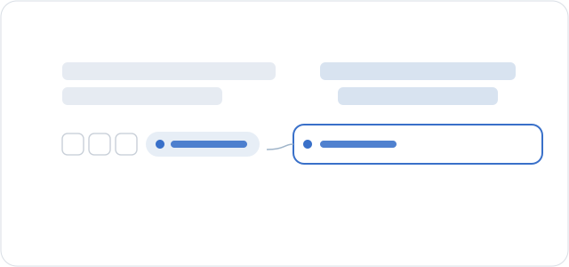

# dsh-turn-model-badge

English | [中文](README.zh-CN.md)

A DeepSeek Harness UI plugin that shows **which model actually served each completed turn** of a conversation.

When you switch models in the middle of one session, older turns keep the name they were served with, so the transcript no longer tells you who answered what. This plugin puts a small blue pill under every completed turn, naming the model that turn really used.

## What it shows

- The model name of each completed turn, e.g. `deepseek-flash`.
- When a turn was retried on a different route, every model that served it is listed, separated by `·`.
- Hovering the pill shows the full `provider/model` list.

## Where the name comes from

The pill reads the per-turn billed attribution that the session log already records
(`turn-tail` → `tokenUsage.routes`). It makes **no extra network request** and sends no data anywhere.

A turn whose attribution is missing — for example a very old turn recorded before that data existed —
shows **no pill at all** rather than a guessed name.

## Requirements

| Item | Value |
|---|---|
| DeepSeek Harness | `>=0.2.2-rc.1 <0.3.0-0` |
| Surface | Web / Desktop (it is a browser-side UI plugin) |

A much older Harness may not offer the conversation slot this plugin registers into, in which case
the plugin installs but draws no pill.

## Install

### From a plugin market index

1. Add this repository's index file URL to your plugin indexes (Settings → Plugins, or the Discover page).
2. Open **Plugins → Discover** and search for `turn model badge`.
3. Install it.

### From a local directory

1. Download this repository (or clone it).
2. In **Plugins**, use **Add plugin** and point it at this directory.

## Uninstall

Open **Plugins**, find **Per-turn model badge**, then switch it off or remove it. Nothing else in your
profile changes.

## Notes and limits

- The pill appears only on **completed** turns; the turn in progress has none yet.
- It reads only display data already present in the session log; it never modifies the log.
- The plugin is display-only: it adds no tools, no commands, and no configuration page.

## License

MIT — see [LICENSE](LICENSE).
