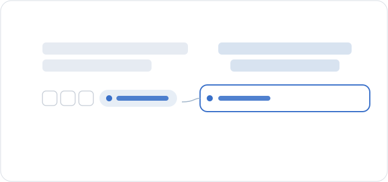

# dsh-turn-model-badge（每轮模型标签）

[English](README.md) | 中文

一个 DeepSeek Harness 的界面小插件：**在每轮已完成的回复下方，显示这一轮实际使用的模型名。**

同一个会话里切换模型之后，之前的回复用的还是旧模型，翻记录时很容易搞不清哪一轮是谁回答的。这个插件会在每轮回复下方放一个蓝色小标签，写明那一轮真正用的模型。

## 显示什么

- 每轮完成回复所使用的模型名，例如 `deepseek-flash`。
- 如果这一轮中途换过线路重试，会把用过的模型都列出来，用 `·` 分隔。
- 鼠标悬停可以看到完整的“提供方/模型”清单。

## 名字从哪里来

标签读取的是会话日志里本来就已经记录的“每轮用量归属”数据
（`turn-tail` → `tokenUsage.routes`），**不额外发任何网络请求**，也不上传任何内容。

个别缺少这份归属数据的轮次（例如记录这份数据之前的老会话），
**不会显示标签**，而不是显示一个猜测的名字。

## 运行要求

| 项目 | 要求 |
|---|---|
| DeepSeek Harness | `>=0.2.2-rc.1 <0.3.0-0` |
| 界面 | Web / 桌面端（这是一个浏览器侧的界面插件） |

如果 Harness 版本过旧，可能没有提供本插件所挂载的对话位置，此时插件能安装但不会画出标签。

## 安装

### 通过插件市场索引

1. 把你的插件索引里这份仓库的索引文件地址加入（设置 → 插件，或“发现”页）。
2. 打开 **插件 → 发现**，搜索 `每轮模型标签`。
3. 点击安装。

### 从本地文件夹安装

1. 下载本仓库（或克隆）。
2. 在 **插件** 页面使用 **添加插件**，指向这个文件夹。

## 卸载

打开 **插件** 页面，找到 **每轮模型标签**，关闭开关或移除即可。不会改动你配置里的其他内容。

## 说明与限制

- 标签只出现在**已完成**的轮次上；正在进行的那一轮暂时没有。
- 它只读取会话日志里已有的显示数据，从不修改日志。
- 这是一个纯显示插件：不新增工具、不新增命令、也没有配置页面。

## 许可

MIT，详见 [LICENSE](LICENSE)。
